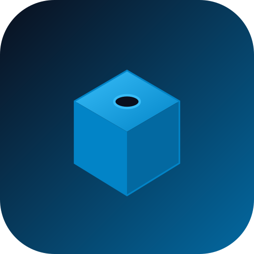

<div align="center">



# VEX IQ 3D CAD Viewer

**Быстрый кроссплатформенный 3D-просмотрщик и интерактивный каталог 476 деталей VEX IQ (STL / 3MF)**

[](https://github.com/vex-ru/vex-iq-step/releases/latest)
[](https://github.com/vex-ru/vex-iq-step/actions/workflows/desktop.yml)
[](https://github.com/vex-ru/vex-iq-step/actions/workflows/deploy.yml)
[](native-rust)
[](src)
[](src/App.tsx)

[Установка в 1 команду](#-быстрая-установка) • [Возможности](#-возможности) • [Управление](#-управление-и-горячие-клавиши) • [Кэш и STL-модели](#-источники-моделей-и-локальный-кэш) • [Сборка из исходников](#-сборка-из-исходников) • [Выпуск релиза](#-выпуск-нового-релиза)

</div>

---

## О проекте

**VEX IQ 3D CAD Viewer** — это единая система для моментального 3D-просмотра, поиска по артикулам (`228-2500-...`) и экспорта STL-файлов всех деталей конструктора **VEX IQ**.

Проект решает проблему хранения и быстрой загрузки сотен тяжёлых CAD-файлов (>1.5 ГБ): сам код репозитория остаётся лёгким, а библиотека `vex-iq-models.zip` размещается в **GitHub Releases** (бесплатный CDN без лимитов трафика) и автоматически кэшируется локально на диске.

Доступны два варианта работы:
1. **Нативное десктопное приложение (Rust + `eframe` + OpenGL 3.3)** — мгновенный запуск, нативный бинарный STL-парсер, низкое потребление памяти, работа офлайн и встроенное автообновление.
2. **Веб-приложение / PWA (React + TypeScript + Three.js + IndexedDB)** — открывается прямо в браузере на GitHub Pages и умеет сохранять модели в локальное хранилище браузера.

---

## 🚀 Быстрая установка

### Windows (1 команда в PowerShell)

Устанавливает программу в профиль пользователя (`%LocalAppData%\Programs\VEX-IQ-Viewer`), создаёт ярлыки на Рабочем столе и в меню «Пуск», регистрирует удаление в системе и поддерживает встроенное автообновление без прав администратора:

```powershell
irm https://raw.githubusercontent.com/vex-ru/vex-iq-step/main/install.ps1 | iex
```

<details>
<summary>Другие варианты для Windows (Setup.exe и Portable ZIP)</summary>

- **Графический инсталлятор**: скачайте `VEX-IQ-Viewer-Windows-x64-Setup.exe` со страницы [Releases](https://github.com/vex-ru/vex-iq-step/releases/latest).
- **Портативная версия (без установки)**: распакуйте `VEX-IQ-Viewer-Windows-x64-Portable.zip` в любую папку и запустите `vex-iq-viewer.exe`.

</details>

### Linux (1 команда через `wget` + `bash`)

Скачивает последний релиз, устанавливает бинарник в `~/.local/share/vex-iq-viewer`, создаёт команду `vex-iq-viewer` в `~/.local/bin`, добавляет иконку и ярлык в меню приложений:

```bash
wget -qO- https://raw.githubusercontent.com/vex-ru/vex-iq-step/main/install.sh | bash
```

> На Ubuntu/Debian для запуска бинарника требуются базовые графические библиотеки: `libgtk-3-0`, `libgl1`, `libxkbcommon0` (обычно уже предустановлены в desktop-системах).

### Web-версия (GitHub Pages / PWA)

Откройте развёрнутое веб-приложение в браузере: **[https://vex-ru.github.io/vex-iq-step/](https://vex-ru.github.io/vex-iq-step/)**  
При необходимости веб-версию можно установить как отдельное PWA-приложение прямо из адресной строки браузера.

---

## 🔄 Встроенное автообновление

В нативное Rust-приложение (Windows и Linux) встроен механизм **самообновления из GitHub Releases** — перекачивать инсталлятор вручную не нужно:

1. При каждом запуске программа в фоне проверяет последний релиз `vex-ru/vex-iq-step`.
2. При выходе новой версии в верхней панели появляется кнопка **`⬆ Обновить vX.Y.Z`** (также проверить вручную можно кнопкой **`🔄 vX.Y.Z`**).
3. По нажатию приложение само скачивает актуальный архив, атомарно обновляет исполняемый файл на диске и перезапускается, полностью сохраняя локальный кэш `./vex_cache/` и настройки.

---

## ✨ Возможности

- **Мгновенный 3D-рендеринг**: модели сразу отображаются на инженерной сетке с шагом **VEX IQ Pitch (`1P = 12.7 мм`)** — даже до загрузки полного архива STL срабатывает быстрая процедурная 3D-генерация деталей.
- **Умный каталог на 476 деталей**:
  - мгновенный поиск по артикулу (`228-2500-227`), названию, размеру в питчах (`1P x 10P`) и имени файла;
  - фильтрация по 10 категориям, быстрые чипы типов деталей (Балки, Шестерни, Колёса, Оси, Пины, Пластины, Уголки), фильтр «Избранное» и «В кэше».
- **Инструменты CAD-инспектора**:
  - 8 фирменных пластиковых цветов VEX IQ;
  - пресеты камеры (`ISO`, `Сверху`, `Спереди`, `Сбоку`), авто-вращение, полигональная сетка (`Wireframe`), габаритный бокс с точными размерами в `мм` и `P`, переключение осей `Z↔Y вверх`;
  - сохранение/экспорт любой модели в бинарный `.stl`.

---

## ⌨️ Управление и горячие клавиши

| Действие | Управление (мышь / клавиатура) |
| :--- | :--- |
| Вращение 3D-модели | **ЛКМ** + перемещение |
| Сдвиг камеры (панорамирование) | **ПКМ** или **СКМ** + перемещение |
| Масштабирование (зум) | **Колесо мыши** |
| Следующая / предыдущая деталь в списке | **`↓`** / **`↑`** или **`→`** / **`←`** |
| Быстрое листание (±10 деталей) | **`PageDown`** / **`PageUp`** |
| Первая / последняя деталь | **`Home`** / **`End`** |
| Быстрая загрузка ZIP / папки / STL | **Drag & Drop** файла или папки прямо в окно |

---

## 📦 Источники моделей и локальный кэш

Чтобы не хранить гигабайты бинарных `.stl` внутри Git-истории, поддерживается 3 способа подключения библиотеки:

1. **Автозагрузка ZIP из GitHub Releases** — при первом запуске укажите ссылку на архив (по умолчанию уже подставлена ссылка на `vex-iq-models.zip` из релиза `vex-ru/vex-iq-step`). Программа скачает и распакует все STL-файлы в локальный кэш.
2. **Локальная папка `stl/`** — если положить папку `stl/` рядом с `vex-iq-viewer` или указать её через **«📁 Папка stl»**, модели подключаются мгновенно без копирования.
3. **Локальный `.zip` или отдельные `.stl`** — перетащите архив/файлы в окно программы или выберите через диалог открытия.

**Где хранится кэш:**
- **Нативное приложение**: в переносной папке `./vex_cache/` рядом с исполняемым файлом (при отсутствии прав на запись — в системном кэше ОС).
- **Web PWA**: в браузерном хранилище `IndexedDB` — модели открываются мгновенно и работают офлайн.

---

## 📂 Категории каталога

| Раздел | Описание | Кол-во |
| :--- | :--- | :---: |
| `01_Beams` | Конструкционные балки `1xN` и `2xN` с шагом 12.7 мм | 78 |
| `02_Plates_and_Panels` | Пластины, панели, щитки и обтекатели | 86 |
| `03_Connectors_and_Corners` | Угловые фиксаторы, тройники и коннекторы | 32 |
| `04_Gears_and_Sprockets` | Прямозубые, конические и коронные шестерни, звёздочки | 42 |
| `05_Shafts_Standoffs_and_Spacers` | Приводные оси, стойки и проставочные втулки | 80 |
| `06_Pins` | Соединительные пины `1x1`, `1x2`, `2x2` и штифты | 19 |
| `07_Wheels_Tires_and_Pulleys` | Колёса, шины, ступицы и шкивы | 35 |
| `08_Motors_and_Power` | Крепления моторов, пропеллеры и приводы | 11 |
| `09_Specialty_Mechanisms_and_Misc` | Ремни, тросы, ковши, захваты и механизмы | 46 |
| `99_Other` | Поворотные основания и прочие узлы | 22 |

---

## 🏗 Структура репозитория

```text
vex-iq-step/
├── .github/workflows/
│   ├── deploy.yml              # Автодеплой Web PWA на GitHub Pages
│   └── desktop.yml             # Сборка Rust-бинарников (Linux/Windows), Setup.exe и vex-iq-models.zip
├── native-rust/                # Нативное приложение на Rust (eframe + glow + glam)
│   ├── assets/                 # Встроенный JSON-каталог (476 деталей, 10 категорий)
│   ├── installer/              # Скрипт Inno Setup (vex-iq-viewer.iss)
│   ├── src/
│   │   ├── app.rs              # UI-интерфейс, тёмная тема, поиск и навигация
│   │   ├── catalog.rs          # Загрузка каталога и поиск по артикулу/питчам
│   │   ├── gl_viewer.rs        # OpenGL 3.3 / GLES 3.0 рендерер и шейдеры
│   │   ├── procedural.rs       # Процедурная генерация 3D-деталей VEX IQ
│   │   ├── stl_loader.rs       # Бинарный и ASCII парсер / экспортёр STL
│   │   ├── storage.rs          # Локальный кэш ./vex_cache/, ZIP и сканер папок
│   │   └── updater.rs          # Встроенное автообновление из GitHub Releases
│   ├── Cargo.toml
│   ├── build_linux.sh          # Сборка Linux-версии и .tar.gz
│   ├── build_windows.ps1       # Сборка Windows-версии (автопоиск MSVC или GNU)
│   └── build_windows.bat       # Batch-обёртка сборки для Windows
├── src/                        # Веб-версия (React 19 + TypeScript + Three.js + Tailwind)
├── public/                     # PWA-манифест и иконки
├── install.ps1                 # Установщик Windows в 1 команду
└── install.sh                  # Установщик Linux в 1 команду (wget + bash)
```

---

## 🛠 Сборка из исходников

### Нативное Rust-приложение

Предварительно установите [Rust / Cargo](https://rustup.rs/).

**Linux (Ubuntu / Debian):**
```bash
cd native-rust
./build_linux.sh
```
Скрипт проверит системные пакеты (`libgtk-3-dev`, `libgl1-mesa-dev`, `libxkbcommon-dev` и др.), соберёт оптимизированный бинарник и упакует `native-rust/dist/VEX-IQ-Viewer-Linux-x64-Portable.tar.gz`.

**Windows (PowerShell):**
```powershell
cd native-rust
.\build_windows.ps1
```
Скрипт автоматически обнаружит MSVC + Windows SDK (`kernel32.lib`), а если Windows SDK не установлен — переключится на автономный `stable-x86_64-pc-windows-gnu` (или укажите `.\build_windows.ps1 -Gnu`). Готовый архив: `native-rust\dist\VEX-IQ-Viewer-Windows-x64-Portable.zip`.

### Веб-приложение (локальная разработка)

Требуется **Node.js 20+**:

```bash
npm install --legacy-peer-deps
npm run dev      # Запуск dev-сервера на http://localhost:3000
npm run lint     # Проверка TypeScript (tsc --noEmit)
npm run build    # Production-сборка в dist/
```

---

## 🏷 Выпуск нового релиза

Все релизные артефакты собираются автоматически через GitHub Actions при пуше Git-тега формата `v*`:

```bash
git tag v1.0.1
git push origin v1.0.1
```

Workflow `/.github/workflows/desktop.yml` автоматически:
1. Подставит номер версии из тега в `native-rust/Cargo.toml` и `vex-iq-viewer.iss`.
2. Соберёт `VEX-IQ-Viewer-Linux-x64-Portable.tar.gz`, `VEX-IQ-Viewer-Windows-x64-Portable.zip` и `VEX-IQ-Viewer-Windows-x64-Setup.exe`.
3. Упакует `vex-iq-models.zip` (если в репозитории присутствует папка `stl/`).
4. Опубликует все файлы в **GitHub Releases**, откуда их сразу увидят установщики и встроенное автообновление.

---

## 📄 Лицензия

Проект распространяется под лицензией **Apache-2.0**.
